# Hardware

The hub is a XIAO ESP32-C3, an nRF24L01 radio and two IR LED drivers on a 24 × 18 hole
perfboard, with through-hole parts only.

## Building notes

- The radio sits under the board with its antenna past the board's edge.
- The six hub LEDs point two to the front, two up, one left and one right, copying the
  original Harmony Hub. Like the original, it can reach devices that aren't directly in
  front of it, by bouncing IR off walls and the ceiling.
- The Harmony mini blaster holds two LEDs in series.
- Keep D6, D8 and D9 free: D6 prints the boot log, and D8 and D9 decide how the chip starts.
